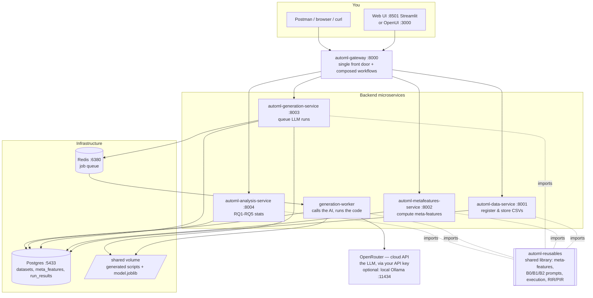

# AutoML Research Stack — Complete Project Guide

> **Read this if you have never seen this project before.**
> It explains what the project is, why it exists, how all the pieces fit together, and
> how to install and run the *entire* system on your own laptop from a blank slate —
> starting with "install Docker and get an AI API key" and ending with "I just generated a
> machine learning pipeline with an AI and scored it." No prior knowledge of the project is
> assumed. Where a technical word first appears, it is explained in plain English.

**Project name:** VESIT AutoML — *LLM-Driven AutoML Conditioned on Dataset Meta-Features*
**GitHub organization:** [Major-Proj-AutoML](https://github.com/Major-Proj-AutoML)
**Archived with a permanent DOI:** [10.5281/zenodo.23543993](https://doi.org/10.5281/zenodo.23543993)
**License:** dual MIT OR Apache-2.0

> **What changed recently (Nov 2026):** the stack now talks to **OpenRouter** (a hosted,
> OpenAI-compatible API) for its AI by default, instead of Ollama. This is because Ollama
> retired the free *cloud* models the project used to rely on. You now just need a free
> **OpenRouter API key** — no large model download, no GPU. A local **Ollama** is still
> supported as an optional fallback. Separately, **MinIO** (the old file-storage service)
> is **disabled by default** — generated scripts and models are kept on a shared folder and
> downloaded through the API instead. Both changes are reflected throughout this guide.

---

## Table of Contents

1. [What is this project, in one minute](#1-what-is-this-project-in-one-minute)
2. [The research idea (the actual point of all this)](#2-the-research-idea-the-actual-point-of-all-this)
3. [Jargon buster — every scary word, explained](#3-jargon-buster--every-scary-word-explained)
4. [How the system is built (architecture)](#4-how-the-system-is-built-architecture)
5. [The repositories at a glance](#5-the-repositories-at-a-glance)
6. [SETUP — from a blank laptop to a running stack](#6-setup--from-a-blank-laptop-to-a-running-stack)
7. [USING the system](#7-using-the-system)
8. [Running the research experiments (sweeps & analysis)](#8-running-the-research-experiments-sweeps--analysis)
9. [Repo-by-repo deep dive](#9-repo-by-repo-deep-dive)
10. [The shared brain: `automl-reusables`](#10-the-shared-brain-automl-reusables)
11. [The database (what gets stored, and where)](#11-the-database-what-gets-stored-and-where)
12. [Everyday commands (stop, restart, wipe)](#12-everyday-commands-stop-restart-wipe)
13. [Troubleshooting](#13-troubleshooting)
14. [License, citation & team](#14-license-citation--team)

---

## 1. What is this project, in one minute

Normally, building a machine-learning model for a dataset is a human job: a data
scientist looks at the data, decides how to clean it, picks an algorithm, writes the
code, trains it, and checks the score. **This project asks a Large Language Model (an AI
like the one behind ChatGPT) to do that job automatically** — you hand it a spreadsheet
(a `.csv` file) and it writes a complete Python machine-learning program, runs that
program, and reports how well the resulting model performs.

That idea alone is called **AutoML** ("Automated Machine Learning"). The *research twist*
that makes this a university major project is the question:

> **If we first measure some statistical "fingerprints" of the dataset and show those
> fingerprints to the AI, does the AI write a better, more trustworthy program than if we
> just hand it the raw task?**

Those statistical fingerprints are called **meta-features** (literally "features about
the data itself" — how many rows, how much is missing, how skewed the numbers are, how
imbalanced the categories are, and so on). The project builds three AI "prompting styles"
— **B0, B1, B2** — that differ only in *how much information about the dataset the AI is
given*, and then compares them head-to-head on real datasets.

The AI itself is **not** something you install or train. The system calls a hosted model
through **OpenRouter** over the internet using an API key you provide — so even a laptop
with no GPU can run the whole thing.

The whole thing is packaged as a set of small cooperating web services (a
**microservice** architecture) that you start with a single command, plus a web page and
an API you can poke at.

---

## 2. The research idea (the actual point of all this)

### The three conditions: B0, B1, B2

Every time the system asks the AI to write a pipeline, it uses one of three **prompt
conditions**. They are identical except for how much context the AI receives:

| Condition | Codename | What the AI is told | Analogy |
|---|---|---|---|
| **B0** | `b0_naive` | *Only* the task: "write me a scikit-learn pipeline for this task." Nothing about the data. | Asking a chef to cook "something with chicken" — no recipe, no pantry list. |
| **B1** | `b1_schema` | The task **+ the dataset's schema**: column names, their types, and the first 3 rows. | The chef now sees the ingredients list. |
| **B2** | `b2_metafeature` | The task + schema **+ a full meta-feature profile + explicit decision rules + a mandatory, machine-checked "reasoning trace".** | The chef sees the ingredients, their freshness/quantities, *and* a rulebook and must write down which rule justified each step. |

B0 and B1 are **baselines**. **B2 is the proposed method.** In B2 the AI is given a JSON
profile of the dataset's meta-features and a numbered rulebook (e.g. *"If more than 5% of
values are missing, prefer `IterativeImputer`"*, *"If a feature is very skewed, apply a
`PowerTransformer`"*, *"If the classes are imbalanced, use `SMOTE` or
`class_weight='balanced'`"*). Crucially, B2 also forces the AI to emit a structured
`REASONING:` line listing each decision, which rule triggered it, which exact meta-feature
number it read, and which scikit-learn class it used.

### The honest headline result

From the experiment sweeps run with this system:

- **On raw accuracy, it's a tie.** Across datasets, B0/B1/B2 land within ±0.02 of each
  other. No condition dominates on score. The story is **not** "B2 is more accurate."
- **B2's cost is real:** it uses 10–20× more tokens and finishes fewer runs (some models
  "run away" and blow past token limits).
- **B2's true contribution is *faithfulness*, not accuracy** — the ability to *mechanically
  verify* that the AI's stated reasoning actually matches the code it wrote.

### The research contribution: RIR / PIR verification

This is the newest and most novel part of the project, titled:

> **Mechanical Verification of Reasoning–Code Alignment in LLM-Driven AutoML Pipelines**

The idea: an AI can *say* it did one thing and *actually code* another. This project builds
a verifier that compares the two mechanically:

- **RIR — Reasoning Intermediate Representation:** the AI's *plan*, parsed into a list of
  atomic, checkable "claims" (e.g. *"I scaled `Fare` with `RobustScaler` because its
  outlier ratio 0.128 exceeds 0.05"*).
- **PIR — Program Intermediate Representation:** what the *generated code actually does*,
  extracted by statically parsing the Python source (its imports, the classes it uses, the
  columns it touches) using Python's built-in `ast` module — no need to run the code.

The verifier checks whether the RIR (what was promised) lines up with the PIR (what was
built). If the AI claims a number it never read, or cites a class it never imported, the
run is flagged **unfaithful** and discarded. This gives a *trustworthiness* guarantee that
raw accuracy numbers can't.

> **Status note:** the RIR/PIR verifier is under active development. Its code lives in
> `automl-reusables/src/verification/`.

### The five research questions (RQ1–RQ5)

The analysis service answers these over all completed runs:

| RQ | Question |
|---|---|
| **RQ1** | Does B2 (meta-feature-guided) produce better scores than B0/B1? (incl. a Wilcoxon significance test) |
| **RQ2** | Does B2 fail less often, and *how* do the conditions fail (error categories)? |
| **RQ3** | Does B2 need fewer retry iterations to get working code? |
| **RQ4** | How do different LLM backends (models) compare? |
| **RQ5** | Does dataset size (small / medium / large) change the picture? |

---

## 3. Jargon buster — every scary word, explained

| Term | Plain-English meaning |
|---|---|
| **LLM (Large Language Model)** | The AI that writes text/code (think ChatGPT). Here it writes Python ML programs. |
| **AutoML** | Automated Machine Learning — getting software (here, an LLM) to build ML models for you. |
| **Pipeline** | A single Python script that loads data → cleans it → trains a model → scores it. |
| **Dataset** | A table of data, here a `.csv` file (like a spreadsheet). One column is the **target** you want to predict. |
| **Target column** | The column the model should learn to predict (e.g. house price, or "survived yes/no"). |
| **Task type** | What kind of prediction: `regression` (a number), `binary_classification` (yes/no), `multiclass_classification` (one of several labels). |
| **Meta-feature** | A statistic *about the dataset as a whole* (row count, % missing, skewness, class imbalance, etc.). The star of this research. |
| **OpenRouter** | A hosted service that gives you one API key to reach many AI models through a single OpenAI-compatible endpoint (`https://openrouter.ai/api/v1`). **This is the project's default AI provider** — the worker calls it over the internet. Get a key at <https://openrouter.ai/keys>. |
| **Ollama** *(optional)* | A free program that runs LLMs on your *own* machine at `http://localhost:11434`. The project can use it as a **fallback** instead of OpenRouter (set `LLM_PROVIDER=ollama`). Not required for the default setup. |
| **API key** | A secret token that proves you're allowed to use a paid/free API. Here, your `OPENROUTER_API_KEY`. Keep it out of screenshots and git. |
| **Docker / Docker Desktop** | Software that runs each service in an isolated "container" so you don't install databases and Python by hand. One command starts everything. |
| **Container** | A lightweight, self-contained box running one piece of software (one service, the database, etc.). |
| **Microservice** | One small web service that does *one* job. This project is ~9 of them cooperating. |
| **API** | The set of URLs a service answers to (e.g. `POST /datasets` uploads a CSV). You call them from Postman, a browser, or code. |
| **Gateway** | A single "front door" service that forwards your request to whichever backend service should handle it. |
| **Postgres** | The SQL database that stores datasets, meta-features, and run results permanently. |
| **Redis** | A fast in-memory store used here as a **job queue** (a to-do list for the worker). |
| **RQ (as in "RQ job")** | *Redis Queue* — the library that puts "generate a pipeline" jobs on the queue for the worker to pick up. (Not to be confused with RQ1–RQ5 research questions above.) |
| **Worker** | A background process that pulls jobs off the queue and actually does the slow work (calling the LLM, running code). |
| **MinIO** *(disabled by default)* | An S3-compatible "file bucket" service that *used* to store generated scripts/models. It is **turned off by default** now (its public images became unavailable); artifacts are kept on a shared folder and served through the API instead. Re-enablable — see `automl-infra` compose comments. |
| **Streamlit** | A Python library for quick web apps — the simple upload-and-run web page lives here. |
| **Seed** | A fixed number that makes randomness repeatable, so the same run gives the same result. |
| **Sweep** | Running *many* combinations at once (every dataset × every condition × every model × every seed) to gather experiment data. |
| **Faithfulness** | Whether the AI's stated reasoning actually matches the code it produced (the RIR vs PIR check). |

---

## 4. How the system is built (architecture)

Nine application pieces sit on top of the infrastructure services. You bring the whole
thing up with **one** Docker command. The AI is **not** in Docker and **not** on your
machine — the worker calls **OpenRouter** in the cloud over HTTPS using your API key.
(Optionally you can point it at a local **Ollama** instead, reached via
`host.docker.internal`.)



### What happens in one full run (the data flow)

1. You upload a CSV and name the target column + task type.
2. **data-service** validates it, splits it into train/test, saves the files, and records
   the dataset in Postgres (it gets an `id`).
3. **metafeatures-service** reads the training file and computes the four meta-feature
   groups, caching them in Postgres.
4. **generation-service** puts a "generate" job on the Redis queue and immediately returns
   a job id (so you're not left waiting).
5. The **worker** picks up the job, builds the prompt for your chosen condition
   (B0/B1/B2) using the shared library, sends it to **OpenRouter** (the default AI
   provider), gets Python code back, **runs that code in an isolated subprocess**, and if
   it fails feeds the error back to the AI and retries up to `max_iter` times.
6. The worker writes the outcome (score, success/failure, error category, token counts,
   timings, and for B2 the reasoning + verification report) to the `run_results` table,
   and keeps the generated script + trained model on a **shared volume** (MinIO is disabled
   by default, so there's no separate upload step).
7. **analysis-service** reads `run_results` and answers the RQ1–RQ5 questions.
8. The **frontend** polls until the run is done, then lets you download the script and the
   trained model (served by generation-service straight from that shared volume).

### Port map (what runs where)

| Thing | URL / host port | Inside Docker |
|---|---|---|
| Gateway (front door) | http://localhost:8000 | `gateway:8000` |
| Data service | http://localhost:8001 | `data-service:8001` |
| Meta-features service | http://localhost:8002 | `metafeatures-service:8002` |
| Generation service | http://localhost:8003 | `generation-service:8003` |
| Analysis service | http://localhost:8004 | `analysis-service:8004` |
| Streamlit web UI | http://localhost:8501 | `frontend:8501` |
| OpenUI web UI | http://localhost:3000 | `frontend-openui:3000` |
| Postgres (database) | localhost:**5433** | `postgres:5432` |
| Redis (queue) | localhost:**6380** | `redis:6379` |
| **OpenRouter (the AI)** | https://openrouter.ai *(cloud)* | reached over the internet with your API key |
| Ollama (optional local AI) | http://localhost:11434 | reached as `host.docker.internal:11434` |

> The database and Redis use *odd* host ports (5433, 6380) on purpose, so this project
> can run alongside any other Postgres/Redis you already have without clashing.
>
> **MinIO is disabled by default** (its `:9000`/`:9001` ports are not exposed). Generated
> scripts and models are downloaded through the generation-service API instead — see
> [Section 11](#11-the-database-what-gets-stored-and-where).

---

## 5. The repositories at a glance

The project is split across **9 Git repositories**. All nine live side-by-side as sibling
folders because the Docker Compose files reference each other by relative path
(`../automl-data-service`, etc.).

| # | Repository | Language | What it is | Container / Port |
|---|---|---|---|---|
| 1 | **automl-infra** | YAML/SQL | The conductor: Docker Compose files, the database schema, Postman snapshots. **You run everything from here.** | |
| 2 | **automl-reusables** | Python | The shared brain: meta-features, the B0/B1/B2 prompts, code execution, the RIR/PIR verifier, experiment logic, and the LLM client (OpenRouter/Ollama). Imported by every service. | (bind-mounted) |
| 3 | **automl-data-service** | Python (FastAPI) | Dataset registry — upload CSVs or import OpenML datasets. | `:8001` |
| 4 | **automl-metafeatures-service** | Python (FastAPI) | Computes & caches the dataset meta-features. | `:8002` |
| 5 | **automl-generation-service** | Python (FastAPI + RQ) | Queues LLM code-generation runs; a worker executes them. | `:8003` + worker |
| 6 | **automl-analysis-service** | Python (FastAPI) | The statistics/analytics over all runs (RQ1–RQ5). | `:8004` |
| 7 | **automl-gateway** | Python (FastAPI) | The single front door + two "do everything in one call" workflows. | `:8000` |
| 8 | **automl-streamlit** | Python (Streamlit) | The simple upload-and-run web page. (Container is named `automl-frontend`.) | `:8501` |
| 9 | **automl-openui** | TypeScript (Next.js) | An alternative chat-style web UI (OpenUI). | `:3000` |

Plus infrastructure containers that `automl-infra` starts for you: **Postgres** (database)
and **Redis** (queue). **MinIO** (file storage) is included in the compose files but
**disabled by default**.

---

## 6. SETUP — from a blank laptop to a running stack

This section assumes **you have installed nothing** and know nothing about the project.
Follow it top to bottom. Commands are shown for **Windows (PowerShell)** since that is the
project's primary environment; macOS/Linux equivalents are noted where they differ.

### Step 0 — Install the prerequisites

You only need to do this once per machine. You do **not** need to install Python, a
database, or (by default) any AI model locally — Docker and OpenRouter handle all of that.

#### 0a. Docker Desktop (runs all the services)

1. Download from **https://www.docker.com/products/docker-desktop/** and install it.
2. Launch Docker Desktop and wait until it says it's running (the whale icon is steady).
3. Verify in a terminal:

```bash
docker --version
```

You should see something like `Docker version 27.x`. If the command isn't found, Docker
Desktop isn't installed or isn't on your PATH — reopen the terminal after installing.

#### 0b. An OpenRouter API key (this is how you get the AI)

OpenRouter is a hosted service that runs the Large Language Model for you — you don't
download or train anything. You just need a key.

1. Create a free account at **https://openrouter.ai**.
2. Go to **https://openrouter.ai/keys** and create a new API key. It looks like
   `sk-or-v1-...`. Copy it somewhere safe.
3. Add a little credit to your OpenRouter account (the default model, `openai/gpt-oss-120b`,
   is very cheap — a test run costs a fraction of a cent). Some models have a free tier.

You'll paste this key into the project's `.env` file in **Step 2**. That's all the AI
setup there is — no `ollama pull`, no GPU, no multi-gigabyte download.

> **Prefer to run the AI locally instead?** You can. Install **Ollama**
> (<https://ollama.com/download>), run `ollama serve`, `ollama pull` a model (e.g.
> `qwen2.5-coder:7b`), and later set `LLM_PROVIDER=ollama` in `.env`. OpenRouter is the
> default and the easiest path, so the rest of this guide assumes it.

#### 0c. Git (downloads the code)

Download from **https://git-scm.com/downloads**, install, and verify:

```bash
git --version
```

#### 0d. Postman (lets you call the API by clicking) — *optional but recommended*

Download from **https://www.postman.com/downloads/**. If you'd rather not install it, you
can use the built-in interactive docs page in your browser instead (explained in Step 7).

---

### Step 1 — Create a folder and clone all nine repositories

The repositories must end up as **siblings inside one parent folder**, because the Docker
Compose files look for each other at `../automl-<name>`. Pick any location you like.

**Windows (PowerShell):**

```powershell
mkdir automl-stack ; cd automl-stack
git clone https://github.com/Major-Proj-AutoML/automl-infra.git
git clone https://github.com/Major-Proj-AutoML/automl-reusables.git
git clone https://github.com/Major-Proj-AutoML/automl-data-service.git
git clone https://github.com/Major-Proj-AutoML/automl-metafeatures-service.git
git clone https://github.com/Major-Proj-AutoML/automl-generation-service.git
git clone https://github.com/Major-Proj-AutoML/automl-analysis-service.git
git clone https://github.com/Major-Proj-AutoML/automl-gateway.git
git clone https://github.com/Major-Proj-AutoML/automl-streamlit.git
git clone https://github.com/Major-Proj-AutoML/automl-openui.git
```

**macOS / Linux:** the same commands work (use `mkdir automl-stack && cd automl-stack`).

After this you should have **nine folders** side by side:

```
automl-stack/
├── automl-infra/              ← you will run commands from here
├── automl-reusables/
├── automl-data-service/
├── automl-metafeatures-service/
├── automl-generation-service/
├── automl-analysis-service/
├── automl-gateway/
├── automl-streamlit/
└── automl-openui/
```

> **Why all nine?** The full Docker Compose file builds the two web UIs
> (`automl-streamlit`, `automl-openui`) from their folders. If they're missing, the "full
> stack" start command fails because it can't find those build folders. Clone all nine and
> you're safe. **Clone the frontend with its real name `automl-streamlit`** — the compose
> file expects the folder to be `../automl-streamlit`.

---

### Step 2 — Set your OpenRouter API key

The stack reads configuration from `automl-infra/.env`. Create it from the template and
paste in your key.

**Windows (PowerShell), from the `automl-infra` folder:**

```powershell
cd automl-infra
copy .env.example .env
notepad .env
```

**macOS / Linux:** `cp .env.example .env` then edit with any text editor.

In `.env`, set your key (the line is already there, just fill it in):

```bash
LLM_PROVIDER=openrouter
OPENROUTER_API_KEY=sk-or-v1-your-key-here
# OPENROUTER_URL=https://openrouter.ai/api/v1   # optional, this is the default
```

That's the only required change. The default model the examples use is
**`gpt-oss:120b-cloud`**, which the stack automatically maps to OpenRouter's
**`openai/gpt-oss-120b`**. You can also pass any OpenRouter model slug directly (e.g.
`openai/gpt-oss-120b`, `anthropic/claude-3.5-sonnet`) — whatever you set as `llm_backend`
when you start a run.

> **Using a local Ollama instead?** Set `LLM_PROVIDER=ollama` and
> `OLLAMA_URL=http://host.docker.internal:11434`, make sure `ollama serve` is running on
> your host with a model pulled, then use that model's name as `llm_backend`.

> **Security:** `.env` holds a secret. It's already in `.gitignore` — never commit it or
> paste the key into screenshots/issues.

---

### Step 3 — Start the entire stack (one command)

From the `automl-infra` folder, bring everything up. The two `-f` flags layer the
application services on top of the base infrastructure.

```bash
cd automl-infra
docker compose -f docker-compose.yml -f docker-compose.full.yml up -d --build
```

- `-d` runs it in the background. Drop it if you'd like to watch the logs scroll live.
- `--build` builds the service images from source (only needed the first time, or after a
  code change).

**The first run takes 5–10 minutes** (it downloads base images and builds the Python
services). Later starts take ~30 seconds.

> The services will **start** even if you forgot the API key — but any generation run will
> fail fast with a clear message telling you to set `OPENROUTER_API_KEY`. Set it in Step 2
> and you're fine.

---

### Step 4 — Verify everything is alive

**A. All containers up?**

```bash
docker compose -f docker-compose.yml -f docker-compose.full.yml ps
```

You want every container `Up`, with `Auto-ML-Postgres` and `Auto-ML-Redis` marked
`(healthy)`. (You won't see a MinIO container — it's disabled by default.)

**B. Is the front door healthy?** Open http://localhost:8000/health in a browser, or:

```bash
curl http://localhost:8000/health
```

Expected — every upstream `true`:

```json
{"status":"ok","upstream":{"data":true,"metafeatures":true,"generation":true,"analysis":true}}
```

**C. Is the AI key wired into the worker?**

```bash
docker exec automl-generation-worker printenv OPENROUTER_API_KEY
```

You should see your `sk-or-...` key printed. If it's blank, re-check Step 2 and restart the
worker (`docker compose -f docker-compose.yml -f docker-compose.full.yml restart generation-worker generation-service`).
The real end-to-end check is simply running a generation (Section 7, Test 3). If any check
fails, jump to [Troubleshooting](#13-troubleshooting).

🎉 **You now have the full stack running.** Move on to actually using it.

---

## 7. USING the system

There are two ways to use it: the **web page** (easiest) or the **API** (for testing and
automation). Both do the same thing under the hood.

### Option A — The web UI (recommended for a first try)

1. Open **http://localhost:8501** (the Streamlit app).
2. Upload any CSV suitable for supervised ML (e.g. a housing dataset).
3. Pick the **target column** (what to predict) and the **task type** (`regression`,
   `binary_classification`, or `multiclass_classification`).
4. Choose a **prompt condition** (`b0_naive`, `b1_schema`, or `b2_metafeature`) and your
   **LLM backend**. The default `gpt-oss:120b-cloud` works out of the box (it maps to
   OpenRouter's `openai/gpt-oss-120b`); you can also type any OpenRouter model slug.
5. Click run. The page registers the dataset, extracts meta-features, enqueues the run,
   and polls until the worker finishes — then lets you **download the generated Python
   script and the trained `model.joblib`.**

There's also an alternative chat-style UI at **http://localhost:3000** (OpenUI).

### Option B — The API (Postman or your browser)

Every service publishes **interactive docs** — just open the `/docs` URL in a browser,
fill in the form, and hit **Execute**. No Postman needed:

- Gateway (covers everything): http://localhost:8000/docs
- Or import the ready-made collections from `automl-infra/postman/` into Postman.

**Everything goes through the gateway at `http://localhost:8000`.** Here's the standard
test walkthrough:

#### Test 1 — Health
`GET http://localhost:8000/health` → expect all upstreams `true`.

#### Test 2 — Upload a CSV and get meta-features (no AI involved, ~1 second)
`POST http://localhost:8000/workflows/upload-and-extract` — in Postman choose **Body →
form-data**:

| Key | Type | Value |
|---|---|---|
| `file` | File | your CSV, e.g. `housing.csv` |
| `target_col` | Text | the column to predict, e.g. `median_house_value` |
| `task_type` | Text | `regression` / `binary_classification` / `multiclass_classification` |

The response includes `dataset.id` and the computed meta-features. **Note the `id`.**

#### Test 3 — Full end-to-end run (AI writes code, runs it, scores it)
`POST http://localhost:8000/workflows/full-run` — same body as Test 2, plus:

| Key | Value | Meaning |
|---|---|---|
| `condition` | `b2_metafeature` | prompt style (`b0_naive` / `b1_schema` / `b2_metafeature`) |
| `llm_backend` | `gpt-oss:120b-cloud` | the model (an alias for OpenRouter's `openai/gpt-oss-120b`; any OpenRouter slug also works) |
| `seed` | `42` | reproducibility |
| `max_iter` | `3` | how many times to retry if generated code fails |
| `timeout_seconds` | `300` | per-attempt limit for the generated code |

You get an **immediate** reply with an `rq_job_id` — the actual work runs in the
background (20–60 s).

#### Test 4 — Poll for the result
`GET http://localhost:8000/runs?dataset_id=<id>&limit=1`

- `[]` → worker hasn't started yet; wait and retry.
- `"success": null` → still running.
- `"success": true` → done — read `test_score`.
- `"success": false` → failed — read `error_category` / `error_message`.

**Reading the score:**
- **Regression** → a *negative RMSE*; closer to 0 is better (`-48728` means an error of
  ~48,728 in the target's units).
- **Classification** → *balanced accuracy* in `[0, 1]`; higher is better.

#### Test 5 — Analytics
Once you have runs, hit the analysis endpoints (also available via the gateway):

| Request | Tells you |
|---|---|
| `GET /analysis/summary` | mean score + success rate per (condition, model) |
| `GET /analysis/errors` | how runs failed, by category |
| `GET /analysis/iterations` | average retries per condition |
| `GET /analysis/models` | per-model comparison |
| `GET /analysis/size-stratified` | small vs medium vs large datasets |
| `GET /analysis/wilcoxon?a=B0&b=B2` | is B2 *significantly* different from B0? |

To *see the research effect*, run the same dataset+model+seed under `b0_naive` and
`b2_metafeature` and compare.

### Peeking at stored data

```bash
# What datasets are registered?
docker exec -it Auto-ML-Postgres psql -U automl -d automl -c "SELECT id, name, target_col, task_type, n_rows FROM datasets;"

# Recent runs
docker exec -it Auto-ML-Postgres psql -U automl -d automl -c "SELECT id, dataset_id, condition, llm_backend, test_score, success, error_category FROM run_results ORDER BY id DESC LIMIT 10;"

# Watch the worker live while a run is in progress
docker logs -f automl-generation-worker
```

The generated **scripts and trained models** are downloaded through the API (MinIO is
disabled by default):

```bash
curl -OJ http://localhost:8000/runs/<run_id>/script   # the generated pipeline .py
curl -OJ http://localhost:8000/runs/<run_id>/model    # the trained model.joblib
```

---

## 8. Running the research experiments (sweeps & analysis)

A single run is one cell. The *research* needs a **sweep**: every combination of
`datasets × conditions × models × seeds`, run in a batch, so the analysis has enough data
to compare B0/B1/B2 fairly.

- Enqueue a sweep: `POST http://localhost:8000/sweeps` (a cartesian product of the
  parameters you pass). Poll its progress with `GET /sweeps/{id}`.
- A sweep typically varies **conditions** (B0/B1/B2) × **LLM backends** (models) ×
  **seeds** over your chosen datasets, giving the analysis enough data to compare the
  conditions fairly.

Once a sweep completes, the `/analysis/*` endpoints produce the RQ1–RQ5 tables.

---

## 9. Repo-by-repo deep dive

Each service is a small **FastAPI** app (Python) unless noted. They all import the shared
`automl-reusables` library, share the Postgres database, and are reachable both directly
and through the gateway.

### 1. `automl-infra` — the conductor
No code of its own; it *orchestrates* the others.
- `docker-compose.yml` — base infra: Postgres + Redis (+ an optional, commented-out MinIO
  block you can re-enable).
- `docker-compose.full.yml` — overlay adding the 5 app services, the worker, and the 2 UIs.
- `.env.example` — the settings template, including `LLM_PROVIDER` / `OPENROUTER_API_KEY`.
- `db/init/*.sql` — the database schema; runs automatically on Postgres's first start.
- `postman/` — OpenAPI snapshots of every service, importable into Postman.
- `CITATION.cff` — citation metadata (authors, version, DOI). GitHub's "Cite this
  repository" button reads this.

### 2. `automl-reusables` — the shared brain
A `pip`-installable Python library imported by every service as `src.*`. It holds the
*actual research logic* — including the LLM client that talks to OpenRouter (or Ollama).
Fully detailed in [Section 10](#10-the-shared-brain-automl-reusables).

### 3. `automl-data-service` (`:8001`) — dataset registry
- Accepts CSV uploads → validates → splits into train/test → caches the files → records
  the dataset in Postgres.
- Imports OpenML datasets by id (a built-in catalogue of 28 CC18 classification datasets +
  Ames Housing for regression).
- Key endpoints: `POST /datasets`, `POST /datasets/openml`, `GET /datasets`,
  `GET /datasets/{id}/preview`, `DELETE /datasets/{id}`.

### 4. `automl-metafeatures-service` (`:8002`) — the "fingerprint" computer
- Given a `dataset_id`, reads the training CSV and computes the **four meta-feature
  groups**, then caches them in Postgres (second call returns the cache unless `?force=true`).
- Key endpoints: `POST /meta-features/{id}` (compute), `GET /meta-features/{id}` (fetch).

### 5. `automl-generation-service` (`:8003` + worker) — the engine room
- The **web** part queues jobs; the **worker** part does the slow work.
- The worker: fetches the dataset → builds the B0/B1/B2 prompt → calls the **LLM provider
  (OpenRouter by default; Ollama optional)** → **runs the generated code in an isolated
  subprocess** → on failure, feeds the error back and retries up to `max_iter` → records
  the outcome in `run_results` → keeps the script + trained model on the shared volume
  (served back through the download endpoints; MinIO disabled by default).
- Key endpoints: `POST /runs`, `GET /runs`, `GET /runs/{id}/script`, `GET /runs/{id}/model`,
  `POST /sweeps`, `GET /sweeps/{id}`.
- Has **two** Dockerfiles: `Dockerfile` (web) and `Dockerfile.worker` (background worker).

### 6. `automl-analysis-service` (`:8004`) — the statistician
- **Read-only.** It never queues work; it aggregates `run_results` to answer RQ1–RQ5
  (including a paired Wilcoxon signed-rank significance test).
- Key endpoints: `GET /analysis/summary|errors|iterations|models|size-stratified`,
  `GET /analysis/wilcoxon?a=B0&b=B2`.

### 7. `automl-gateway` (`:8000`) — the front door
- Re-exposes every backend endpoint under one base URL, handles CORS for the browser UIs,
  and adds two **composed workflows** that chain multiple services in one call:
  - `POST /workflows/upload-and-extract` — upload → meta-features.
  - `POST /workflows/full-run` — upload → meta-features → enqueue a run.
- `GET /health` reports the health of all four upstream services at once.

### 8. `automl-streamlit` (`:8501`) — the simple web page
- A single-file **Streamlit** app (`app.py`). Upload a CSV, pick a condition + model, run,
  and download the script + trained model. Talks only to the gateway. (Its container is
  named `automl-frontend`.)

### 9. `automl-openui` (`:3000`) — the alternative UI
- A **Next.js / TypeScript** chat-style frontend (OpenUI). Points at the gateway and, for
  its own chat box, at an OpenAI-compatible endpoint. By default that chat still points at
  a local Ollama (`/v1`), so the OpenUI chat feature needs Ollama running — the main
  pipeline generation uses OpenRouter regardless.

---

## 10. The shared brain: `automl-reusables`

Everything that *is* the research lives here, under `src/`. It's importable as `src.*` by
every service (the services bind-mount this folder and set `PYTHONPATH`, so editing a file
here and restarting one service picks up the change — no rebuild).

| Module | What it does |
|---|---|
| `src/contracts.py` | The shared data shapes (Pydantic models): `MetaFeatures`, `RunResult`, `GeneratedPipeline`, `ErrorCategory`, `TaskType`. The "common language" every service speaks. |
| `src/conditions/` | **The B0/B1/B2 prompt builders.** `base.py` defines the interface; `b0_naive.py`, `b1_schema.py`, `b2_metafeature.py` each build the prompt text for that condition. The B2 file also contains the numbered decision rulebook and the mandatory structured-reasoning spec. |
| `src/meta_features/` | **The meta-feature extractors**, in four groups: `simple.py` (counts, missingness, class balance), `distributional.py` (skewness, outliers), `information.py` (correlations), `landmarking.py` (quick "probe" model scores). `extractor.py` ties them together. |
| `src/execution/` | Runs the AI-generated code safely. `runner.py` executes a pipeline in an isolated subprocess (and auto-inserts missing scikit-learn "enable-experimental" imports); `error_taxonomy.py` classifies *why* a run failed (`import_error`, `missing_name`, `infrastructure`, …); `metrics.py` scores it; `verification.py` is the original B2 faithfulness check. |
| `src/experiments/` | Research orchestration + **the LLM client**: `runner.py` holds `call_llm` / `call_llm_with_usage`, which route to **OpenRouter** (`openai/gpt-oss-120b` and friends) or **Ollama** based on `LLM_PROVIDER`, and also parse token usage; `datasets.py` (load OpenML + custom CSVs); `analysis.py` (the RQ1–RQ5 functions the analysis-service exposes). |
| `src/verification/` | **The new RIR/PIR verifier (the research contribution).** `rir.py` = Reasoning Intermediate Representation (the AI's plan as checkable claims); `pir.py` = Program Intermediate Representation (what the code actually does, via Python's `ast`); `engine.py`, `evaluation.py`, `cli.py` drive and score the comparison. Pure standard-library so it runs anywhere. |

### The four meta-feature groups (what B2 actually "sees")

1. **Simple** — row/column counts, overall missing ratio, number of numeric vs categorical
   columns, class balance ratio.
2. **Distributional** — per-column skewness and outlier ratios.
3. **Information** — pairwise correlations between features (e.g. max/mean correlation).
4. **Landmarking** — the scores of cheap "probe" models (a decision stump, 1-NN, a linear
   model) that hint at how hard the problem is and what kind of model might suit it.

The B2 rulebook maps thresholds on these numbers to concrete preprocessing choices (e.g.
*"outlier ratio > 0.05 → use `RobustScaler`"*), and the verifier later checks the AI really
followed what it claimed.

---

## 11. The database (what gets stored, and where)

Postgres holds four tables (schema in `automl-infra/db/init/`). Everything the system does
leaves a durable record here.

| Table | Holds | Key columns |
|---|---|---|
| `datasets` | One row per registered CSV/OpenML dataset. | `id`, `name`, `source` (`openml`/`custom`), `target_col`, `task_type`, `train_path`, `test_path`, `n_rows`, `n_cols` |
| `meta_features` | The cached meta-feature profile per dataset (as JSON). | `dataset_id`, `features` (JSONB), `computed_at` |
| `run_results` | **The heart of the data** — one row per AI run. | `dataset_id`, `condition` (`B0`/`B1`/`B2`), `llm_backend`, `seed`, `success`, `test_score`, `error_category`, `iterations_used`, `runtime_seconds`, `prompt_tokens`, `completion_tokens`, `total_tokens`, `generated_code_path`, and for B2: `reasoning_trace` + `verification_report` (JSONB) |
| `sweep_jobs` | Progress of batch sweeps. | `rq_job_id`, `status`, `params`, `total_cells`, `completed_cells`, `failed_cells` |

- **Generated files** — the `.py` scripts and the trained `model.joblib` — are written to a
  **shared volume** (`automl-reusables/logs/runs/`, mounted into both the worker and the
  generation-service). You download them through `GET /runs/{id}/script` and
  `GET /runs/{id}/model`. The `run_results.generated_code_path` column records where each
  script lives.
- **MinIO** (the old S3-style store for these files) is **disabled by default** — its
  images are no longer publicly pullable. The compose files keep it as a commented-out,
  re-enablable block if you have a mirror you trust.
- **Redis** stores the live job queue (transient — it's a to-do list, not a record).

---

## 12. Everyday commands (stop, restart, wipe)

Run these from the `automl-infra/` folder. `COMPOSE` below is shorthand for
`-f docker-compose.yml -f docker-compose.full.yml`.

| Goal | Command |
|---|---|
| Start everything | `docker compose $COMPOSE up -d --build` |
| Stop everything (keep data) | `docker compose $COMPOSE down` |
| Restart one service after a code change | `docker compose $COMPOSE restart <service-name>` |
| Rebuild after a Dockerfile change | `docker compose $COMPOSE up -d --build` |
| **Wipe everything** (deletes the DB, Redis, uploaded CSVs) | `docker compose $COMPOSE down -v` |

Service names for `restart`: `postgres`, `redis`, `data-service`, `metafeatures-service`,
`generation-service`, `generation-worker`, `analysis-service`, `gateway`, `frontend`,
`frontend-openui`. (There is no `minio` service by default.)

> Changed your API key or switched `LLM_PROVIDER` in `.env`? Restart the worker and
> generation service so they pick it up:
> `docker compose $COMPOSE restart generation-worker generation-service`.

---

## 13. Troubleshooting

| Symptom | Likely cause & fix |
|---|---|
| `/health` shows an upstream `false` | That service crashed on startup. `docker logs <that-container>` — usually a Python import error. |
| A service exits immediately with `No module named 'psycopg'` | A SQLAlchemy 2.1 quirk: a bare `postgresql://` URL now wants the psycopg **v3** driver, which isn't installed. The stack ships the fix (`DATABASE_URL` uses `postgresql+psycopg2://`). Make sure you're on the latest `automl-infra`, then recreate: `docker compose $COMPOSE up -d --force-recreate`. |
| A run stays "still running" for minutes | The AI provider is unreachable or the key is missing. `docker logs automl-generation-worker`, and confirm `OPENROUTER_API_KEY` is set (`docker exec automl-generation-worker printenv OPENROUTER_API_KEY`). |
| Run row shows `error_category: "infrastructure"` | The worker couldn't reach the AI: missing/invalid `OPENROUTER_API_KEY`, no OpenRouter credit, or no internet. (If using Ollama: `ollama serve` isn't reachable.) The error message says which. |
| Run row shows `error_category: "missing_name"` | The AI wrote code using a name it never imported. This is *expected sometimes* — the pipeline auto-retries up to `max_iter`. |
| `401`/`402` or auth/credit error from OpenRouter | Check the key is correct in `.env`, and that your OpenRouter account has credit (or the model has a free tier). Then restart the worker. Or switch to a local model with `LLM_PROVIDER=ollama`. |
| `Port is already allocated` on `5433` or `6380` | Something else uses those host ports. Free them, or set `POSTGRES_PORT` / `REDIS_PORT` in `automl-infra/.env`. |
| `No module named 'src'` in a service log | The `../automl-reusables` folder isn't a sibling. Confirm all nine repos sit side by side. |
| `up --build` fails saying it can't find `../automl-streamlit` or `../automl-openui` | You didn't clone all nine repos, or you cloned the frontend under the wrong name. The frontend repo must be the folder **`automl-streamlit`** (Step 1). |
| Want to run the AI locally | Set `LLM_PROVIDER=ollama` and `OLLAMA_URL=http://host.docker.internal:11434` in `.env`, run `ollama serve` with a model pulled, then restart the worker. |
| Everything is wedged | `docker compose $COMPOSE down` then `docker compose $COMPOSE up -d --build`. |

---

## 14. License, citation & team

**License.** Dual-licensed under **Apache-2.0 OR MIT** (your choice). Every repository
ships `LICENSE-APACHE`, `LICENSE-MIT`, and `NOTICE`.

**Citation.** This work is archived on Zenodo with a permanent DOI. The concept DOI always
resolves to the latest version:

[](https://doi.org/10.5281/zenodo.23543993)

Full author/version metadata is in `automl-infra/CITATION.cff` (or use GitHub's "Cite this
repository" button on the `automl-infra` repo).

**Project.** *VESIT AutoML* — a final-year B.E. (AI & Data Science) major project exploring
whether showing an LLM a dataset's meta-features produces better — and, above all, more
*verifiable* — automated ML pipelines. The newest thread — mechanical verification of
reasoning–code alignment (RIR/PIR) — is under active development.

---

*If you only want to bring up the stack and call the APIs, the condensed version lives in
`automl-infra/README.md`.*
